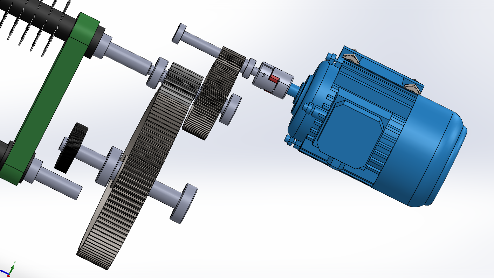
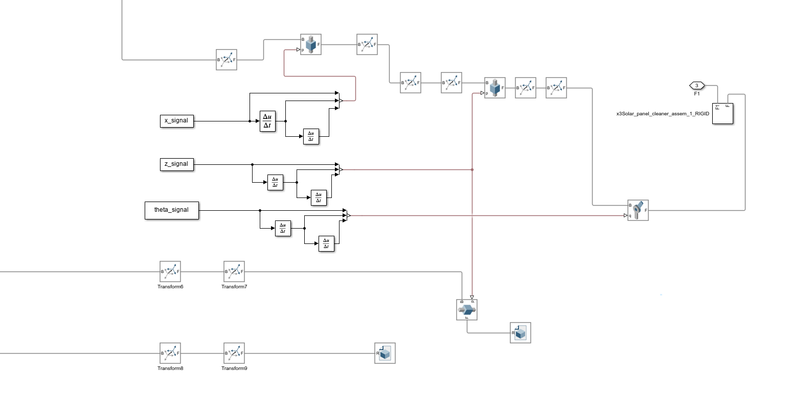

# Solar Panel Cleaning Robot

[](https://opensource.org/licenses/MIT)
[](https://www.mathworks.com/products/matlab.html)
[](https://www.mathworks.com/products/simulink.html)
[](https://www.mathworks.com/products/simscape-multibody.html)
[](https://www.solidworks.com/)

A comprehensive mechatronics design project for an **autonomous solar panel cleaning robot**. This repository covers the full design workflow across both project phases: **actuation, mechanical design, sensors**, and **MATLAB / Simscape Multibody / Simulink simulations**, supported by 3D CAD modeling in **SolidWorks**.

<p align="center">
  
</p>

---

## 📄 Overview

The project aims to design a robot capable of navigating across solar panel arrays while performing dry cleaning, crossing panel misalignments, and avoiding obstacles. This repository covers:

- Detailed functional requirement analysis
- Actuator sizing & selection (DC geared motor, stepper, servo)
- Sensor suite design (incremental encoder, ultrasonic, IR edge detection, ZED Mini stereo camera)
- Central processing unit selection (ESP32)
- Mechanical design with static and dynamic calculations (slope climbing, obstacle crossing, gearbox design)
- 3D CAD modeling and mass property analysis in SolidWorks
- Full system simulation in MATLAB, Simulink and Simscape Multibody with trajectory generation and animation

The project was carried out at the **University of Tehran** under the supervision of **Dr. Hadi**.

---

## 🎯 Key Functional Requirements

| Requirement                  | Specification                               |
| ---------------------------- | ------------------------------------------- |
| Surface slope                | Up to 25°                                   |
| Obstacle crossing (vertical) | 10 mm step                                  |
| Lateral misalignment max     | 50 mm                                       |
| Linear speed                 | 10 m/min                                    |
| Position accuracy            | 1 mm (encoder resolution 0.062 mm achieved) |
| Dry cleaning brush           | Integrated, driven from the same gearbox    |
| Edge & obstacle detection    | IR sensor + ultrasonic + stereo vision      |
| Control unit                 | ESP32 dual-core microcontroller             |

---

## ⚙️ System Architecture

### Drivetrain (Actuation)

- **Main motor**: DC geared motor ZGA37 (1 N·m nominal)
- **Alternatives evaluated**: NEMA23 stepper (0.9 N·m), Shayang IG23 geared motor (0.98 N·m)
- **Custom 2-stage gearbox**: total ratio 25.3:1, efficiency 85%
- **Side wheel servo**: Delta ASDA-B2 / LS Mecapion L7N / Yaskawa Sigma-7 (selected based on 12 N·m design torque for misalignment crossing)

<p align="center">
  
</p>

### Sensors

- **Incremental encoder**: 120 PPR, optical disc → 0.062 mm linear resolution
- **Ultrasonic sensor**: step & height difference detection up to 10 mm (safety factor 2.5)
- **IR edge sensor (E18-D80NK)**: modulated 38 kHz, reaction distance 0.67 mm + braking distance 13.89 mm → safety factor 3.43
- **ZED Mini stereo camera**: 3D depth perception, sensor fusion with point sensors
- **ESP32**: real-time sensor data processing, motor control, safety logic, communication with vision system

### Mechanical Design

- 3D model and assembly in SolidWorks
- Mass: 28.01 kg
- Center of mass kept low for stability on inclined surfaces
- Principal moments of inertia verified against design assumptions
- Passive lateral wheel mechanism for panel misalignment correction

<p align="center">
  
</p>

---

## 🧮 Key Calculations (Excerpt)

- **Slope force**: $F_{gravity} = 28.01 \times 9.81 \times \sin(25^\circ) \approx 116.12\ \text{N}$
- **Design force with safety factor 2.25**: $F_{design} \approx 632.86\ \text{N}$
- **Wheel torque required**: $T_{wheel} \approx 18.98\ \text{N·m}$
- **Obstacle climb analysis** (10 mm step): required torque validated against motor capacity
- **Side wheel climb force**: $F_{climb} \approx 187.7\ \text{N}$ → servo design torque 12 N·m

Full derivation available in the report.

---

## 🖥️ Simulation

### Simulink / Simscape Multibody

- **Trajectory generation**: 40 s custom 3-cycle back-and-forth motion with vertical lifts at panel edges
- **Rigid body model** imported from SolidWorks with exact mass properties
- **Motion signals**: prescribed position → velocity via derivative blocks → applied to multibody joints
- **Visualization**: 3D animation showing robot motion, brush contact, and edge crossing

<p align="center">
  
</p>

### MATLAB Pre-processing

Four initialization scripts must be executed before running any simulation:

1. `CALCULATE_TRAJECTORY.m`
2. `FINAL.m`
3. `FINAL2.m`
4. `MODIFIED_CALCULATE_TRAJECTORY.m`

These populate the workspace with trajectory data, kinematic parameters, and mechanical coefficients required by the Simulink models.

### Output

- Position, velocity, and torque plots
- Robot animation saved in the `Animations/` folder
- Six different simulation scenarios available

---

## 📁 Repository Structure

```
├── Animations/
├── MATLAB/
│   ├── CALCULATE_TRAJECTORY.m
│   ├── FINAL.m
│   ├── FINAL2.m
│   ├── MODIFIED_CALCULATE_TRAJECTORY.m
│   └── (additional analysis scripts and Simscape simulation)
├── PICS/
├── Solid/
│   └── solar_panel_cleaner_assembly.SLDASM (and parts)
├── WORD-PDF-Docs/
├── README.md
└── LICENSE
```

> The report is written in **Persian (Farsi)**. An English abstract is included at the end of the document.

---

## 🚀 Getting Started

1. **Clone the repository**

```bash
   git clone https://github.com/rezaxr14/solar-panel-cleaning-robot.git
   cd solar-panel-cleaning-robot
```

2. **Open MATLAB** and navigate to the project root.
3. **Run the four pre-processing scripts** in sequence (see the `MATLAB/` folder) to load all parameters into the workspace.
4. **Open the Simulink model** and press **Run** to see the simulation and animation.
5. (Optional) Open the SolidWorks assembly in `Solid/` to inspect the 3D mechanical design.

Ensure you have **Simscape Multibody** and **Control System Toolbox** installed.

---

## 👥 Authors

- **Reza Nadimi**
- **Behrad Mashadi Zamani Jalayer**

Supervisor: **Dr. Hadi**
University of Tehran, Faculty of New Sciences and Technologies
Department of Mechatronics Engineering – Fall 1404–1405 (2025–2026)

---

## 📃 License

This project is licensed under the MIT License – see [LICENSE](LICENSE) for details.

---

*For any questions or collaboration, feel free to open an issue or pull request.*
